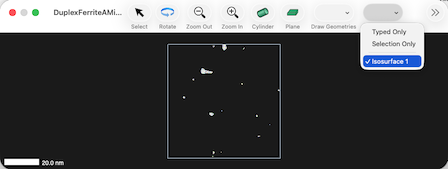

#### previous topic: [Isosurfaces](Isosurfaces.md)   next topic: [Subsets](Subsets.md)

## Isosurface Ions

In the same way that the proxigram groups ions together that are a certain distance away from the interface, each ion has a "distance to the surface" associated with it.  Sinterapt allows the definition of a shell of ions at a certain distance from the interface by specifying two properties of the surface:

- shell center:  The center of the shell ( negative values are inside the surface )

- shell thickness:  The thickness of the cell

Based on these two properties, each surface defines a set of ions whose distance from the surface (distToSurf) is greater than  shell center (center) minus half the shell thickness  (thickness)  and  less than  shell center minus plus the shell thickness 

    distToSurf > (center - (0.5 * thickness)) AND distToSurf < (center + (0.5 * thickness)) 

The following script gets the coordinates of every ion in a shell of thickness 0.1 nm centered on a distance 2 nm inside the surface 

```
tell application "Sinterapt"
	tell document 1
		set shell center of surface 1 to -2.0
		set shell thickness of surface 1 to 0.1
		coordinates of every ion of surface 1
	end tell
end tell
```

The display in the graphics window can also be filtered to only those ions by selecting the surface in the "Ion Filters" dropdown, as shown here:



The ions in the specified shell then become accessible in the scripting object hierarchy.  For example, they can be counted, and their properties can be queried.  In this example, simply counting them:

```
tell application "Sinterapt"
	tell document 1
		count ions of surface 1
	end tell
end tell

--> 12094
```

or in this example, getting the coordinates of each of them:

```
tell application "Sinterapt"
	tell document 1
		get coordinates of every ion of surface 1
	end tell
end tell

--> {{y:37.199600219727, x:-1.650835037231, z:-87.087097167969}, 
{x:-1.456619501114, y:37.289081573486, z:-87.244873046875}, 
{x:-1.417216181755, y:37.127826690674, z:-87.29109954834}, 
{x:-1.670113801956, y:36.384609222412, z:-86.889572143555}, ....
```


#### previous topic: [Isosurfaces](Isosurfaces.md) next topic: [Subsets](Subsets.md)
